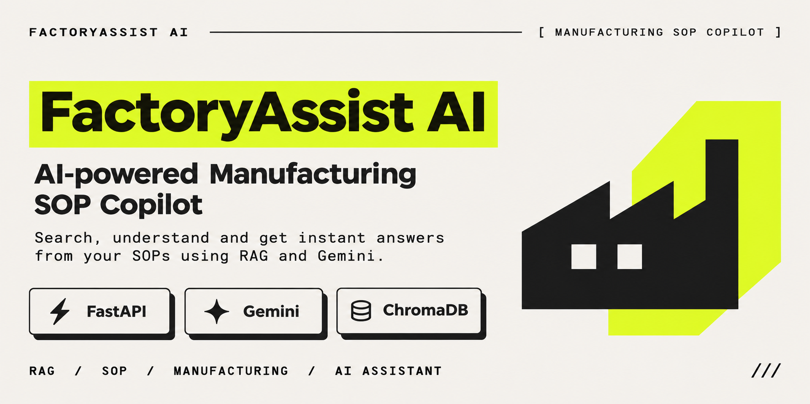

<p align="center">
  
</p>

# FactoryAssist AI — Manufacturing SOP Copilot

An AI copilot for manufacturing shop-floor supervisors. Supervisors ask a
practical question in natural language and get an answer grounded strictly in
the plant's own controlled documents — safety procedures, maintenance manuals
and quality SOPs — with the document code, revision and page number attached.

The application refuses to answer when the documents do not contain the
information, and it never retrieves superseded revisions.

[4½-minute walkthrough](assets/demo/factoryassist-demo.mp4) · [workflow GIF](assets/demo/factoryassist-workflow.gif) · [screenshots](assets/screenshots/)

---

## Problem

Supervisors on the shop floor need answers in seconds: what coolant
concentration to run, what an alarm code means, who may remove a lockout lock,
what tolerance applies to a bearing housing. That knowledge lives in PDF SOPs
that are hard to search under time pressure, and old revisions stay in
circulation. A wrong answer on a safety or quality question is expensive.

Generic chatbots make this worse: they answer confidently from general
knowledge and cannot show where an instruction came from.

## Target users

- Manufacturing supervisors and shift leads on the shop floor.
- Maintenance technicians and quality inspectors checking a procedure.
- Anyone who needs to verify which revision of a document is current.

## Key features

- **Grounded answers only** — retrieval-augmented generation restricted to the
  indexed, active documents.
- **Page-level citations** — document title, code, revision, page and filename
  for every answer.
- **Revision-aware corpus** — QC-SOP-014 Rev 04 is active; Rev 03 is archived
  and excluded from retrieval, never merged with Rev 04.
- **Explicit refusal** — a clear fallback message when the evidence is
  insufficient, with no invented values, procedures or citations.
- **Live operational dashboard** — corpus, index and configuration status,
  knowledge-base view, and a chat interface with source cards.
- **Document management** — managers upload SOP PDFs, review the processed
  result, activate a revision (which archives the one it replaces) or reject it.
  Only active, approved revisions are searchable.
- **Role-based access control** — `ADMIN`, `SOP_MANAGER` and `EMPLOYEE` roles,
  hashed passwords, HttpOnly session cookies, CSRF protection, login rate
  limiting and an audit trail of governance actions.
- **Mobile-friendly** — usable from a phone on the same Wi-Fi network.

---

## Technology stack

| Layer | Technology |
| --- | --- |
| Backend | Python 3.12, FastAPI, Uvicorn |
| Configuration | python-dotenv, Pydantic Settings |
| AI generation | Google Gemini API (`google-genai` 2.34.0) |
| Embeddings | Gemini Embedding API (`gemini-embedding-001`) |
| Vector database | ChromaDB 1.5.9 (local, persistent) |
| PDF processing | PyMuPDF 2.1 |
| Accounts, sessions, audit | SQLite (standard library) + PBKDF2-HMAC-SHA256 |
| Frontend | HTML5, CSS3, vanilla JavaScript (no framework) |

No React, Node.js, Next.js, Flask, LangChain or LlamaIndex is used.

## Architecture

```
PDFs → PyMuPDF extraction → page-scoped chunking → JSON (Stage 2)
                                                      │
                                     Gemini embeddings│
                                                      ▼
                                             ChromaDB (active only)
                                                      │
question → Gemini query embedding → cosine search ───┘
                                                      │
                            evidence + strict prompt ▼
                                             Gemini generation
                                                      │
                                 answer + cited sources (API/UI)
```

Four rules hold the design together:

1. Chunks never cross a page boundary, so every citation is exact.
2. Only active revisions are embedded into the vector store.
3. The generation prompt forbids outside knowledge and invented citations.
4. Sources are built from the chunks that were actually retrieved and used —
   never from model text.

---

## Project structure

```
factoryassist-ai
├── backend/
│   ├── main.py                     # FastAPI app, dashboard + API
│   ├── api/
│   │   ├── auth.py                 # Login, sessions, accounts, audit
│   │   ├── chat.py                 # POST /api/chat
│   │   ├── deps.py                 # Session, role and CSRF dependencies
│   │   ├── documents.py            # Upload, review, activate, archive
│   │   └── health.py               # GET /health, GET /api/status
│   ├── core/
│   │   ├── config.py               # Centralised Pydantic Settings
│   │   └── security.py             # Password hashing, tokens, policy
│   └── services/
│       ├── document_pipeline.py    # Stage 2: extract + chunk + write JSON
│       ├── document_registry.py    # Verified document metadata/revisions
│       ├── pdf_processor.py        # PyMuPDF page extraction
│       ├── text_chunker.py         # Page-scoped overlapping chunks
│       ├── embedding_service.py    # Gemini embeddings (batched, retried)
│       ├── vector_store.py         # ChromaDB collection wrapper
│       ├── ingestion_service.py    # Embed + index active chunks
│       ├── knowledge_base.py       # Manifest + managed document metadata
│       ├── auth_store.py           # Users, sessions, audit log (SQLite)
│       ├── management_store.py     # Uploaded revisions and their status
│       ├── document_manager.py     # Validation, processing, activation
│       ├── rag_service.py          # Retrieval, grounding, citations
│       └── gemini_client.py        # Shared client, error descriptions
├── frontend/
│   ├── index.html                  # Dashboard shell
│   ├── css/styles.css              # Core design system
│   ├── css/management.css          # Document management styles
│   └── js/app.js                   # Views, chat, management, auth
├── Documents/
│   ├── active/                     # 3 current SOPs/manuals
│   ├── archived/                   # QC-SOP-014 Rev 03
│   └── sample_questions/           # Assignment sample questions
├── data/processed/                 # Generated JSON (git-ignored)
├── data/managed/                   # Accounts, audit, upload records (git-ignored)
├── Documents/uploads/              # Uploaded PDFs (git-ignored)
├── vector_store/chroma_db/         # ChromaDB persistence (git-ignored)
├── assets/
│   ├── factoryassist-banner.png    # Repository banner
│   ├── screenshots/                # 1920 × 1080 captures of the running app
│   └── demo/                       # Walkthrough video, workflow GIF, narration script
├── screenshots/                    # Earlier 1280 × 900 captures
├── tests/                          # Offline unit tests (no API key)
├── requirements.txt
├── .env / .env.example
└── README.md, THINKING.md, DEMO_SCRIPT.md
```

The original PDFs also remain untouched in `Documents/`; the pipeline reads only
the three sub-folders.

---

## Prerequisites

- Windows with Python 3.12 installed (`py -3.12 --version`).
- Internet access for the Gemini API (document processing works offline).
- A Google Gemini API key for embeddings and answers.

## Installation

```bat
cd "factoryassist-ai"
py -3.12 -m venv .venv
.venv\Scripts\activate
python -m pip install --upgrade pip
pip install -r requirements.txt
```

## Configure the Gemini API key

The application starts and serves the dashboard without a key, but chat and
ingestion stay disabled until one is present.

1. Open `.env` in the project root (copy `.env.example` if it is missing).
2. Set the key:

```ini
GEMINI_API_KEY=your-key-here
GEMINI_MODEL=gemini-3.5-flash-lite
GEMINI_EMBEDDING_MODEL=gemini-embedding-001
GEMINI_THINKING_LEVEL=low
```

3. Restart the server. No source change is needed — the key is read at startup
   and never sent to the browser.

`.env` is git-ignored. Do not commit it.

### Model and generation settings

`GEMINI_MODEL` must be a model enabled for your key. `/api/status` reports the
model in use; a model your key cannot use returns `404 NOT_FOUND`. To list what
is available:

```bat
python -c "from backend.services.gemini_client import create_client; [print(m.name) for m in create_client().models.list()]"
```

`GEMINI_THINKING_LEVEL` (`minimal`, `low`, `medium`, `high`, or `off`) is sent
only to Gemini 3 and newer. Gemini 3 replaced the older *thinking budget* with
`thinking_level`, and rejects a budget — including `thinking_budget=0`, which
older models accepted — with `400 INVALID_ARGUMENT`. Gemini 2.x models and
unversioned aliases are sent no thinking hint at all and use the API default.
If a model family ever rejects the hint, the request is retried once without it
before the error is reported.

All generation calls use the strict evidence-bound system prompt, temperature
`GEMINI_TEMPERATURE`, `GEMINI_MAX_OUTPUT_TOKENS` and a JSON response schema.

### Model availability in `/api/status`

`gemini.configured` only says that a key is present. The status payload also
carries the result of a saved availability probe, so a typo in `GEMINI_MODEL` is
visible before the first question:

| Field | Meaning |
| --- | --- |
| `model_status` | `ready`, `unavailable`, `unauthorized`, `not_configured` or `unknown` |
| `model_available` | `true` / `false`, or `null` when the check could not run |
| `model_detail` | short, secret-free explanation when the model is not ready |
| `model_checked_at` | UTC timestamp of the probe |

The probe lists the models enabled for the key, uses its own 10-second timeout
and is cached for `GEMINI_MODEL_CHECK_TTL_SECONDS` (default 600), so dashboard
refreshes do not trigger a Gemini request each time. Add `?refresh=true` to the
URL to force a fresh check. A failed probe never fails the endpoint: an
unreachable API reports `unknown`, a rejected key reports `unauthorized`, and a
model that is not listed (or cannot `generateContent`) reports `unavailable`.
The dashboard turns this into its "AI service ready" / "AI model unavailable"
badge, the AI-service KPI and the Model availability row on System Info.

## Document processing (Stage 2)

Only needed when the PDFs change:

```bat
python -m backend.services.document_pipeline
```

Writes `data/processed/active_chunks.json`, `archived_chunks.json`,
`document_manifest.json` and `sample_questions_extracted.json`.

## Indexing (Stage 3)

```bat
python -m backend.services.ingestion_service
```

Embeds the active chunks and writes them to the ChromaDB collection
`factoryassist_active_documents`. Re-running is safe: unchanged chunks are
skipped, changed chunks are updated, and removed chunks are deleted — no
duplicates. Requires `GEMINI_API_KEY`.

## Create the first administrator

Document management is closed until an account exists. There are two supported
ways to create the first one; both keep the password out of the repository.

**Option A — environment variables (created once, at startup):**

```bat
notepad .env
```

```ini
INITIAL_ADMIN_USERNAME=plantadmin
INITIAL_ADMIN_PASSWORD=<choose a strong password, 12+ characters>
INITIAL_ADMIN_FULL_NAME=Plant Administrator
```

Restart the application. If the account database is empty, the administrator is
created and the log records `admin_bootstrap`. The variables are ignored once
any account exists, so they can be removed afterwards.

**Option B — command line (prompts without echoing):**

```bat
.venv\Scripts\python.exe -m backend.services.auth_store create-admin --username plantadmin
.venv\Scripts\python.exe -m backend.services.auth_store list-users
```

Further accounts are created by an administrator from the Document Management
screen or with `POST /api/users`. Full instructions: `ADMIN_SETUP_GUIDE.md`.

## Run the application

```bat
uvicorn backend.main:app --host 0.0.0.0 --port 8000
```

Open <http://127.0.0.1:8000>. The dashboard and API are served from the same
origin; there is no separate frontend server.

## Access from a phone on the same Wi-Fi

1. Find the laptop's IPv4 address:

```bat
ipconfig
```

2. Open `http://<LAPTOP-IP>:8000` on the phone (for example
   `http://192.168.1.24:8000`).
3. Both devices must be on the same Wi-Fi network.
4. If Windows Firewall prompts, allow Python on **private** networks. If it was
   dismissed earlier, allow `python.exe` through Windows Defender Firewall for
   Private networks.

The server binds to `0.0.0.0`, so it is reachable on the local network, but it
is not exposed to the public internet and there is no cloud deployment.

## API

| Method | Path | Purpose |
| --- | --- | --- |
| `GET` | `/` | Dashboard in a browser; application info JSON for API clients |
| `GET` | `/health` | Health check — `{"status": "healthy"}` |
| `GET` | `/api/status` | Service and model availability, corpus, revisions, retrieval settings |
| `POST` | `/api/chat` | Grounded answer with sources |
| `POST` | `/api/auth/login` | Sign in (rate limited, audited) |
| `POST` | `/api/auth/logout` | End the current session |
| `GET` | `/api/auth/me` | Current user, role and CSRF token |
| `POST` | `/api/auth/change-password` | Change your own password |
| `GET` | `/api/documents` | Searchable register (`?status=`, `?q=`) — manager |
| `GET` | `/api/documents/stats` | Counters for the management dashboard |
| `GET` | `/api/documents/meta` | Categories, departments, limits |
| `POST` | `/api/documents/upload` | Upload and process a PDF (multipart) |
| `GET` | `/api/documents/{key}` | Document metadata and revision history |
| `GET` | `/api/documents/{key}/status` | Processing status |
| `GET` | `/api/documents/{key}/file` | Download the stored PDF |
| `POST` | `/api/documents/{key}/activate` | Activate a revision, archive its predecessor |
| `POST` | `/api/documents/{key}/archive` | Retire an active revision |
| `POST` | `/api/documents/{key}/reject` | Reject a pending revision |
| `POST` | `/api/documents/{key}/retry` | Reprocess a failed upload |
| `PATCH` | `/api/documents/{key}` | Edit metadata — administrator |
| `GET` | `/api/users` · `POST` · `PATCH` | Account management — administrator |
| `GET` | `/api/audit` | Audit trail — administrator |
| `GET` | `/docs` | Interactive OpenAPI documentation |

### `POST /api/chat`

```json
{ "question": "What does alarm AL-104 mean?" }
```

```json
{
  "status": "answered",
  "answer": "...",
  "sources": [
    {
      "document_id": "mnt-man-cnc-02-rev02",
      "document_title": "Preventive Maintenance Manual - TX-200 CNC Turning Centre",
      "document_code": "MNT-MAN-CNC-02",
      "revision": "02",
      "page_number": 2,
      "source_filename": "MNT-MAN-CNC-02_TX-200_Preventive_Maintenance.pdf",
      "similarity": 0.71
    }
  ],
  "grounded": true,
  "detail": null
}
```

`status` is one of `answered`, `insufficient_evidence`, `not_configured`,
`error`, `invalid_question`. Business outcomes return HTTP 200 with an explicit
status; empty questions return 400 and malformed bodies 422.

### Error reporting

Failures are classified instead of being reported as one generic error, and the
supervisor-facing `answer` never mentions the API key unless credentials are
truly at fault:

| Gemini result | Reported to the user | Server log |
| --- | --- | --- |
| `400 INVALID_ARGUMENT` | request/model-setting problem, explicitly *not* a key problem | `400 INVALID_ARGUMENT` + API message |
| `401` / `403` | check `GEMINI_API_KEY` | `401 UNAUTHENTICATED` + API message |
| `404 NOT_FOUND` | configured model unavailable, check `GEMINI_MODEL` | `404 NOT_FOUND` + API message |
| `429` | rate limit reached, try shortly | `429 RESOURCE_EXHAUSTED` |
| `5xx` | service temporarily unavailable | code + API message |
| timeout | request took too long | exception type |

The `detail` field carries the short `code STATUS` diagnostic (with API keys
and `key=` parameters redacted); stack traces and key material never leave the
server.

## Document management

Open **Document Management** in the sidebar after signing in. The view has the
upload form, a searchable register with status filters, a detail panel with
revision history, and (for administrators) the audit trail.

### Roles

| Role | Can do | Cannot do |
| --- | --- | --- |
| `ADMIN` | Everything a manager can, plus account management, audit log and metadata edits | — |
| `SOP_MANAGER` | Upload, review, activate, reject and archive SOP revisions | Manage accounts, read the audit log, edit metadata |
| `EMPLOYEE` | Use the assistant over active documents | Any management action (HTTP 403) |

Every check is enforced in the API. Hiding a button is not the control: the
management routes reject anonymous callers with **401** and insufficient roles
with **403**, and mutating routes also require the session's CSRF token.

### Upload and review workflow

1. A manager drops a PDF and fills in document ID, title, revision, department,
   category, effective date and description.
2. The upload is validated (PDF signature, extension, MIME type, size limit,
   readability, page count, extractable text, duplicate code/revision).
3. The file is stored under a generated name; text is extracted with the same
   PyMuPDF code as the baseline pipeline and chunked by the same chunker.
4. Chunks are embedded once and stored in ChromaDB with
   `document_status = pending_review`.
5. The revision appears as **Pending review**. It is not searchable.
6. A manager **activates** it, **rejects** it, or leaves it pending. A failed
   upload can be **retried** without paying for the same embeddings twice.

### Statuses

| Status | Meaning | Retrieved by the assistant? |
| --- | --- | --- |
| `processing` | Extraction/embedding in progress | No |
| `pending_review` | Processed, awaiting a manager | No |
| `active` | Approved and current | **Yes** |
| `archived` | Superseded or retired | No |
| `rejected` | Refused by a manager | No |
| `failed` | Processing failed | No |

### Revision activation guarantees

- Only one revision of a document code can be `active`.
- Activation flips the new revision's chunks to active in the vector store, then
  commits both record changes (new active, old archived) in a **single atomic
  write**. If that write fails, the chunk status is rolled back and the previous
  revision stays active.
- The superseded revision's chunks are then removed. Even if that cleanup fails,
  the status filter already excludes them.
- The previous revision is never archived before the replacement is processed.

### Validation rules worth knowing

- A real PDF signature is required; the filename and MIME type alone are not
  trusted.
- Scanned or image-only PDFs are rejected with a clear message (no OCR in this
  build).
- Documents are classified by keyword density as a **review aid**; an unrelated
  document is flagged in the table and detail panel but still needs a human
  decision.
- Archived, pending, rejected and failed revisions are never returned by
  retrieval, regardless of what the browser sends.

Full operator instructions: `DOCUMENT_MANAGEMENT_GUIDE.md`. Account and role
setup: `ADMIN_SETUP_GUIDE.md`. What was built, changed and tested:
`DOCUMENT_MANAGEMENT_IMPLEMENTATION_REPORT.md`.

## Sample questions

The five assignment questions, also offered as chips in the UI:

1. What is the recommended coolant concentration for the TX-200 CNC?
2. What does alarm AL-104 mean?
3. Who can remove a LOTO lock?
4. What is the tolerance for bearing housing BH-220?
5. How often should spindle runout be checked?

### Expected answers and citations

Taken from the source PDFs; the application generates these itself at runtime —
nothing is hardcoded.

| # | Expected answer | Source |
| --- | --- | --- |
| 1 | Coolant concentration 6 – 8 %, checked with a refractometer reading × 1.0 factor | MNT-MAN-CNC-02 Rev 02, page 1, §3 |
| 2 | AL-104 = way lube oil level low. Top up with ISO VG 68 oil to the MAX mark, then press RESET; the machine can continue after reset | MNT-MAN-CNC-02 Rev 02, page 2, §6 |
| 3 | Each authorised person removes only their own lock; nobody may remove another person's lock | SAF-SOP-003 Rev 05, page 1, §5 |
| 4 | Outer diameter 90.000 mm with ±0.050 mm tolerance, checked with a digital caliper, class Major | QC-SOP-014 Rev 04, page 2, §6 |
| 5 | Monthly, by a maintenance technician (spindle runout limit 0.005 mm at the chuck face) | MNT-MAN-CNC-02 Rev 02, page 1, §3–4 |

### Unanswerable question

> "What is the annual electricity consumption of the factory?"

Expected: `status: "insufficient_evidence"`, the fixed fallback sentence, and
**no sources**. The value appears nowhere in the documents, so nothing is
invented.

## How answers are produced

1. The question is embedded with the configured embedding model.
2. The top 5 chunks by cosine similarity are retrieved from the active
   collection only, then filtered by `RETRIEVAL_MIN_SIMILARITY` (default 0.30).
3. Each chunk is re-checked against the manifest: its revision must be the
   active revision for its document code.
4. Gemini receives the numbered evidence blocks and a system prompt that
   permits only facts from that evidence, forbids invented values, steps and
   citations, and requires the exact fallback sentence when unsupported.
5. The model returns JSON (`answer`, `supported`, `used_source_indices`);
   sources are assembled from the chunks it used. If it reports `supported:
   false`, the server returns the fallback with no sources.

### Active versus archived revisions

| Document | Active | Archived |
| --- | --- | --- |
| QC-SOP-014 Incoming Material Inspection | Rev 04 (01-Jul-2026) | Rev 03 (15-Mar-2023) |
| SAF-SOP-003 Lockout/Tagout | Rev 05 (12-Feb-2026) | — |
| MNT-MAN-CNC-02 TX-200 Maintenance | Rev 02 (20-Jan-2026) | — |

Rev 03 stays in `data/processed/archived_chunks.json` for reference and in the
Knowledge Base view, but it is never embedded into the active collection, never
retrieved, and never cited.

## Tests

Ninety-two offline tests run without an API key or network access. They cover
upload validation, the processing and retry paths, revision activation and
archival, retrieval exclusion for every non-active status, authentication,
role enforcement, CSRF, rate limiting (per account and per client address),
session expiry, audit logging and the original chat contract. Each test uses its own temporary database, upload
directory and vector store, and replaces Gemini embeddings with a deterministic
stub.

```bat
python -m unittest discover -s tests -t . -v
python -m compileall backend tests
```

Test files: `tests/test_gemini_integration.py`, `tests/test_status_availability.py`,
`tests/test_document_management.py`, `tests/test_access_control.py`.

Live checks against a configured key are a separate manual run — see
`Project status` below and `DOCUMENT_UPLOAD_TEST_REPORT.md`, which records the
HTTP validation run (86 pass, one fixture-related fail that passed on retest),
the three defects fixed during it and the browser walkthrough of the management
screen.

## Demo

[`assets/demo/factoryassist-demo.mp4`](assets/demo/factoryassist-demo.mp4) is a
**4:37** walkthrough recorded from the running application (1920 × 1080,
H.264/AAC, 7.2 MB). It shows the dashboard, the Knowledge Base, the runtime
configuration, three grounded answers with page-level citations, an explicit
refusal, and the manager-only document-management screen.

The narration is **synthetic speech** (Windows SAPI) reading the script in
[`assets/demo/README.md`](assets/demo/README.md), which also lists the scene
timings and the exact questions asked. Nothing was staged: it is a screen
recording of `http://127.0.0.1:8000` driven by real HTTP requests, and the
register is shown empty because no revision was submitted for the recording.

[`assets/demo/factoryassist-workflow.gif`](assets/demo/factoryassist-workflow.gif)
is a 20-second excerpt of the same flow — dashboard, question, answer, citation.

## Screenshots

`assets/screenshots/` holds ten images captured from the running application, not
mock-ups: eight at 1920 × 1080, one laptop viewport (1280 × 900) for the
archived-revision detail and one phone viewport (390 × 844).

| File | Shows |
| --- | --- |
| `01-dashboard.png` | Dashboard: KPI tiles, corpus table, starter questions |
| `02-assistant-coolant.png` | Coolant concentration answered from MNT-MAN-CNC-02 Rev 02 p1 |
| `03-assistant-alarm.png` | Alarm AL-104 answered from page 2 of the same manual |
| `04-source-citations.png` | BH-220 tolerance answered from QC-SOP-014 **Rev 04** |
| `05-knowledge-base.png` | Active corpus and the archived Rev 03 |
| `06-document-upload.png` | Upload form filled with a draft revision, not submitted |
| `07-revision-management.png` | Knowledge Base at a laptop viewport — archived Rev 03, superseded by Rev 04 |
| `08-role-permissions.png` | Manager-only Document Management view |
| `09-abstention.png` | "No matching evidence" with no source card |
| `10-mobile-view.png` | Assistant answering on a 390 × 844 phone viewport |

The earlier eight captures (1280 × 900) remain in `screenshots/` and are still
accurate for the assistant views. `DEMO_SCRIPT.md` holds the narration script
and the recording checklist.

## Security notes

- `GEMINI_API_KEY` lives only in `.env` (git-ignored) and on the server; the
  browser never receives it.
- No credentials, stack traces or key material are returned by the API.
- `.venv/`, `data/processed/`, `vector_store/chroma_db/`, caches and logs are
  git-ignored.
- `DEBUG` is off by default (`.env.example` ships `DEBUG=False`), so an
  unexpected error cannot return a traceback or frame locals to the browser.
  Set `DEBUG=True` only while developing locally.
- Management requires an account. Passwords are stored only as salted
  PBKDF2-HMAC-SHA256 hashes (600,000 iterations), session cookies are HttpOnly
  and SameSite=Lax, and each mutating request needs the session's CSRF token.
- Session cookies are marked `Secure` automatically when the request arrives over
  HTTPS (or set `SESSION_COOKIE_SECURE=true` behind a TLS proxy). On plain local
  HTTP the flag is omitted so the cookie still works; do not expose that setup to
  the internet.
- Repeated failed sign-ins are refused for a window: `LOGIN_MAX_ATTEMPTS`
  (5) per account and `LOGIN_IP_MAX_ATTEMPTS` (20) per client address, and every
  attempt is audited.
- Passwords are never written to logs, audit records or API responses.
- Answers should support, not replace, the controlled SOP and the responsible
  supervisor.

## Known limitations

- Requires a paid/free-tier Gemini API key; without it the UI runs but chat and
  ingestion are disabled with a clear message.
- No OCR: scanned pages without a text layer are reported as extraction
  warnings and left empty.
- Tables are extracted as plain text, so very wide tables read awkwardly in
  chunks.
- The similarity floor (0.30) and `RETRIEVAL_TOP_K` (5) are sensible defaults,
  but have not been tuned on a large corpus.
- Single-plant, single-collection deployment with local SQLite accounts; no
  SSO or external identity provider.
- The chat itself stays open on the plant network (by design) while document
  management requires a session; the assistant therefore does not attribute
  questions to employees.
- Corporate proxy/TLS termination is out of scope; run it yourself if the app
  must be reached over HTTPS.
- Uploaded revisions are processed inside the upload request, and activation uses
  an in-process lock, so run one Uvicorn worker.

## Project status

Stages 1–7 are implemented: foundation, PDF processing, embeddings/ChromaDB,
RAG, FastAPI + dashboard, documentation, and the document-management system
with role-based access control.

Ingestion and live generation were verified against the Gemini API with
`gemini-embedding-001` and `gemini-3.5-flash-lite`: 15 active chunks indexed, and
the six questions below answered from the correct document, revision and page.
The unanswerable question returns the fallback sentence with no sources.

The document-management stage was validated over the real HTTP API and in a
browser: role matrix, CSRF, upload failure modes, workflows A–E, the audit trail
and a mobile viewport. Three defects found in that pass — an address-wide login
lockout, a CSS rule that defeated `hidden`, and rejected PDFs left on disk on
Windows — were fixed and covered by tests. Results, including what was not run,
are in `DOCUMENT_UPLOAD_TEST_REPORT.md`.

**Verified questions** (live API, sources as returned):

| Question | Result |
| --- | --- |
| TX-200 coolant concentration | 6 – 8 %, MNT-MAN-CNC-02 Rev 02 p1 |
| Alarm AL-104 meaning and action | way lube low; ISO VG 68 to MAX then RESET, Rev 02 p2 |
| Personal lock removal (LOTO) | each person removes only their own lock, SAF-SOP-003 Rev 05 p1 |
| BH-220 OD tolerance | ±0.050 mm (90.000 mm nominal), QC-SOP-014 Rev 04 p2 |
| Spindle runout inspection | monthly by a maintenance technician, MNT Rev 02 p1 |
| Annual electricity consumption | `insufficient_evidence`, fallback, no sources |

QC-SOP-014 Rev 03 never appeared in any answer or source list.
